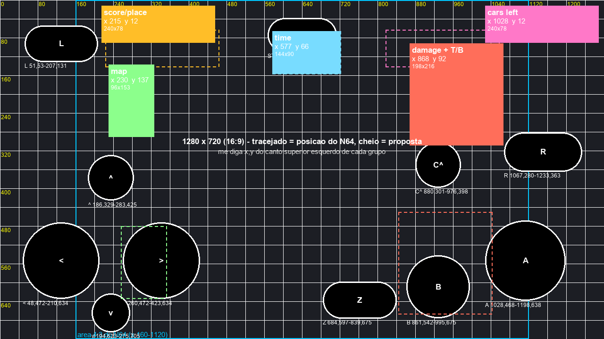

# Widescreen HUD layout

Wrecked Metal mode only (Play Fidelity keeps the N64's HUD). The race HUD is drawn by the
game in a 4:3 area in the middle of the screen; on a wide screen the port moves whole HUD
groups toward the screen's edges (`port/game/wm_mod.c` `WM_HudOffset`, applied by
`port/fast3d/gfx_pc.cpp` as a shift of the 4:3 area for that group's draws). One player
only; split screen keeps the N64's places.



## Coordinates

Positions are the **top-left corner of each group in pixels of a 1280x720 (16:9) screen**:
3 pixels per N64 pixel, the N64's 4:3 area from x 160 to x 1120. On a wider phone the left
groups keep their distance from the left edge and the right groups from the right edge,
like the touch buttons do; `time` keeps to the centre.

Set them in `Data/wm_tuning.ini`:

```ini
[hud]
layout = 1            ; 0 = the N64's HUD
start_lights = 0.40   ; size of the red / yellow / green start lights (1.00 = the N64's)
score = 215 12        ; score/place, left edge   (240x78)
time = -1 -1          ; centre                   (144x90), -1 -1 = the N64's place
cars_left = 1028 12   ; right edge               (240x78)
map = 230 137         ; left edge                (96x153)
damage = 868 92       ; right edge: damage gauge + T/B bars (198x216)
```

The file is read when a race starts, so changes apply from the next race.

## Groups and their elements (Ui_Draw ids, `include/ids.h`)

| Group | Elements | N64 top-left (N64 px) |
| --- | --- | --- |
| score | SCREEN_BOX1 (168), texts 436 444 413 518 | 21, 21 |
| time | SCREEN_BOX3 (170), texts 434 512 | 139, 22 |
| cars_left | SCREEN_BOX2 (169), texts 504 424 | 219, 21 |
| map | RADAR_SP (14), CAR_RADAR_* (15-29) | 32, 160 |
| damage | HEALTH_* / WIRE_* (40-55), speed text 522, Wrecked Metal T/B bars | 228, 150 |
| start lights (scaled) | READY/SET/GO (260-262), halos (263-265), orange light + halo (161, 162) | 111, 30 |

## Touch buttons on the template (arrows layout, S23 at 720 lines)

From `TouchControlsView` (dp offsets from the edges, x1.85 px/dp): L 51,53-207,131;
START 567,37-712,110; arrows < 48,472-210,634, > 260,472-423,634, ^ 186,329-283,425,
v 194,623-275,705; C^ 880,301-976,398; R 1067,280-1233,363; A 1028,468-1198,638;
B 861,542-995,675; Z 684,597-839,675. With the analog stick instead of arrows, the stick
appears wherever the left 45% of the screen below the top quarter is touched.
